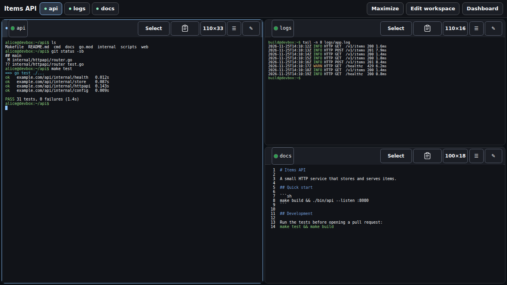
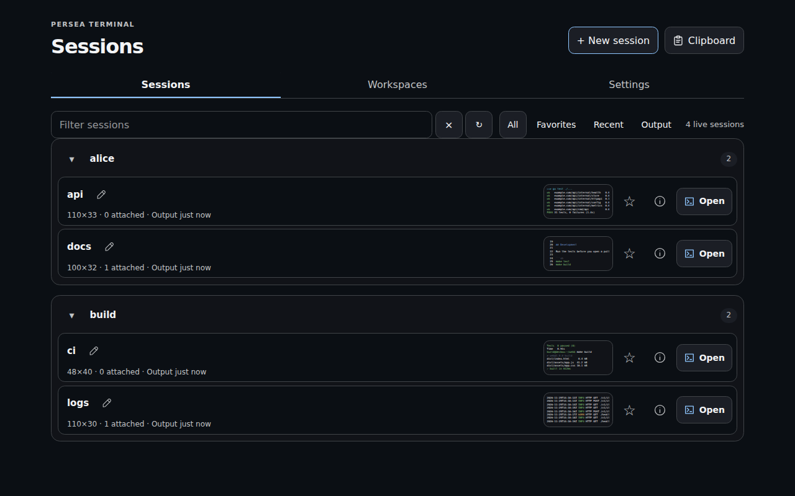
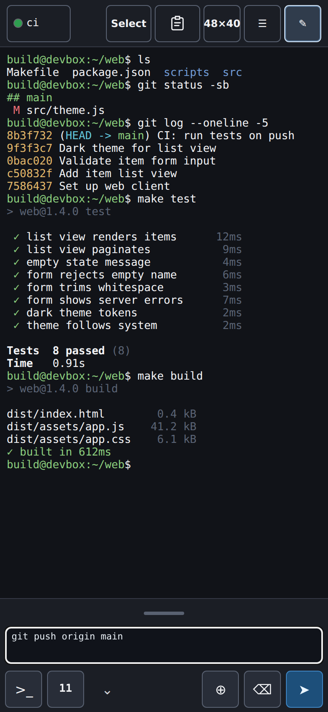
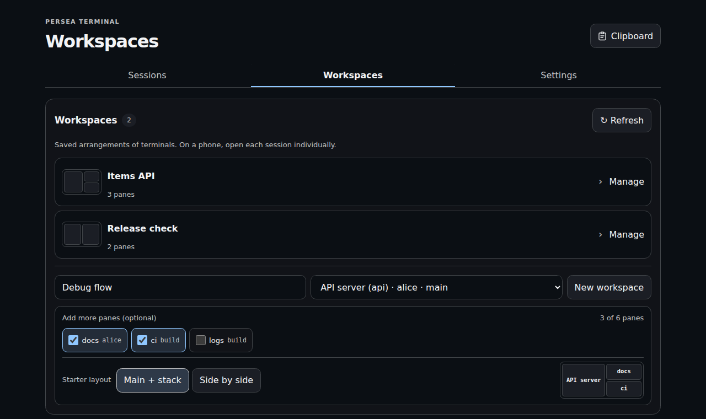
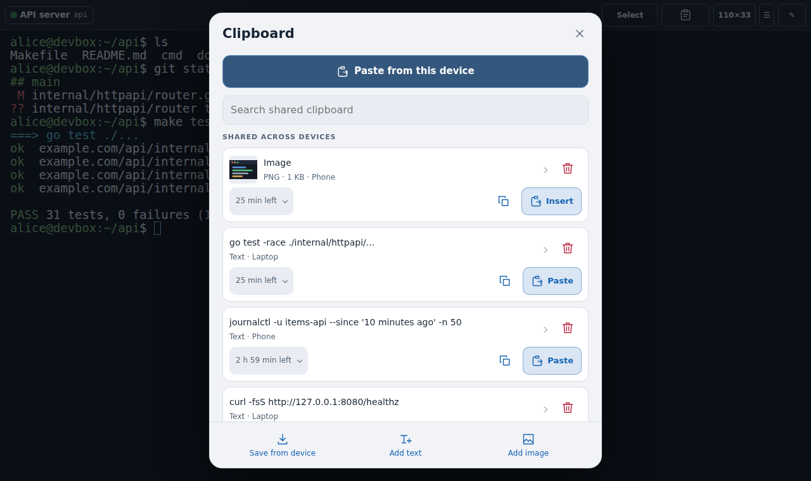
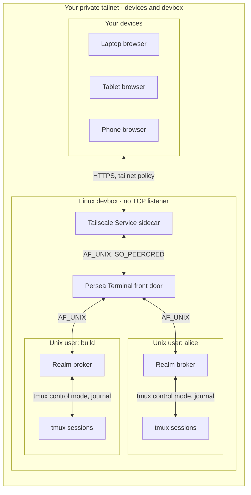

#  Persea Terminal

**Your tmux sessions, in a browser on your tailnet.**

Run Persea Terminal on your Linux devbox and reach your shells, editors, builds,
and coding agents from a laptop, tablet, or phone. Your work stays on the devbox
when you close the browser or lose your connection.

- **Keep sessions together.** Arrange up to six terminals in saved multi-pane [workspaces](ui/workspaces.md) with starter layout presets, visual editing, pane maximize, and quick switching.
- **Pick up where you left off.** Reconnect restores retained output over compressed incremental catch-up; uncertain input is never replayed.
- **Use your existing workflow.** Native tmux clients can stay attached. Opening a browser or adjusting workspace panes never resizes your session; geometry refits happen only on explicit request.
- **Share text and images across devices.** A built-in [shared clipboard](ui/clipboard.md) supports direct device paste, expiring text and image clips, OSC 52 copies, and composer image staging (`Cmd/Ctrl+V` or drag and drop).
- **Work from a phone.** Touch controls, a text composer with image attachments, a customizable [terminal key bar](ui/KEYBOARD_CONTROLS.md), and eight themes keep common actions close.



<table>
  <tr>
    <td width="62%"></td>
    <td width="38%"></td>
  </tr>
  <tr>
    <td align="center">Sessions for each configured Unix user</td>
    <td align="center">The same sessions from a phone</td>
  </tr>
</table>

<details>
<summary>More views: saved Workspaces and shared Clipboard</summary>
<br>
<table>
  <tr>
    <td width="50%"></td>
    <td width="50%"></td>
  </tr>
  <tr>
    <td align="center">Saved workspaces and layout builder</td>
    <td align="center">Shared cross-device text and image clipboard</td>
  </tr>
</table>
</details>

## How it works



Connect your devices to Tailscale and open the terminal's Service URL.
[Tailnet access rules](https://tailscale.com/kb/1552/tailscale-services) determine
which devices can reach it; Persea Terminal also verifies the configured Tailscale
login. The deployment runs a dedicated `tailscaled` Service sidecar on the devbox
and forwards requests to the front door over a local Unix socket (`SO_PEERCRED`),
with no TCP listener. Each configured Linux user account (called a *realm*) runs
its own isolated broker under that user's Unix UID and communicates with explicitly
configured tmux servers over tmux control mode (`-C`) and a typed per-session journal.

**Access is private and single-operator:** one configured person can access all
configured realms. Only explicitly configured tmux servers are available. See the
[security model](SECURITY.md), the [deployment guide](deploy/README.md), and
[terminal reconstruction](docs/terminal-reconstruction.md) for isolation,
lifecycle, and capture details.

## Get started

### Requirements

- **Server:** Linux and tmux. Production installation also uses systemd, Tailscale,
  and administrator access.
- **Build from source:** Go, Node.js, and npm at the versions specified in
  [go.mod](go.mod), [ui/.nvmrc](ui/.nvmrc), and [ui/package.json](ui/package.json);
  Bash, Python 3, and standard GNU utilities.
- **Client:** a modern browser; Tailscale access for remote use. Node.js and npm
  are not needed to run the installed service.

### Quick Start

On your devbox, follow the [deployment guide](deploy/README.md), or ask a coding
agent to work through it with you:

1. **Choose what to expose.** Configure the Unix users, their tmux servers, and
   your Tailscale login in `/etc/persea-terminal/host.json`, using
   [host.example.json](deploy/host.example.json) as a starting point.
2. **Build and install.** Prepare the required toolchain, then run the installer.
   It installs the web service and a broker running as each configured Unix user.
3. **Set up private access.** Enroll the service's dedicated Tailscale identity;
   approve its Service and restrict access to the intended users and devices
   through your tailnet policy. Persea Terminal also checks your configured login.
4. **Open your terminals.** Visit the Service's HTTPS URL from an allowed device.
   In the dashboard, choose a configured Unix user and open an existing tmux
   session, create a new one, or open a saved workspace.

Keep your host manifest and credentials outside the repository.

Each configured Unix user needs a running tmux server at the configured socket.
Start it on the host as that user, or arrange for that user's service to restore
it at boot. Persea Terminal waits for tmux and never starts a server itself: a
server started by the broker would inherit its restricted filesystem, lack of
network access, and lifetime, so restarting the broker would end its shells.
"New session" is available only while the configured tmux server is running.

### Try it locally

Clone or download this repository to your Linux devbox, then run from the
repository directory:

```sh
scripts/local-start.sh
```

The launcher installs dependencies, builds the application, and prints a local
`URL=` to open. It creates an isolated tmux session for the demo. Use the printed
`STOP_COMMAND=` when finished; `TMUX_ATTACH=` lets you return to that session.
This demo is local to the devbox; follow Quick Start above for other devices.

## Documentation

- **User interface:** [Dashboard and session discovery](ui/dashboard.md) · [Workspaces](ui/workspaces.md) · [Shared clipboard](ui/clipboard.md) · [Scrollback](ui/scrollback.md) · [Keyboard controls](ui/KEYBOARD_CONTROLS.md)
- **Operations and security:** [Deployment guide](deploy/README.md) · [Security model](SECURITY.md)
- **Internals and protocols:** [Terminal reconstruction](docs/terminal-reconstruction.md) · [Attachment wire protocol](internal/attachmentwire/README.md) · [Clipboard storage and API](internal/frontdoor/clipboard.md)

## Help and contributing

Bug reports and contributions are welcome. Include steps to reproduce and your
browser and operating system; remove terminal content and private network details
before sharing logs.

- [Contributing and tests](CONTRIBUTING.md) · [Agent instructions](AGENTS.md)
- [Dependency updates and the xterm patch](ui/DEPENDENCIES.md)
- [Changelog](CHANGELOG.md) · [Releases](RELEASING.md)
- [Security and vulnerability reporting](SECURITY.md)

## License

[MIT](LICENSE).
