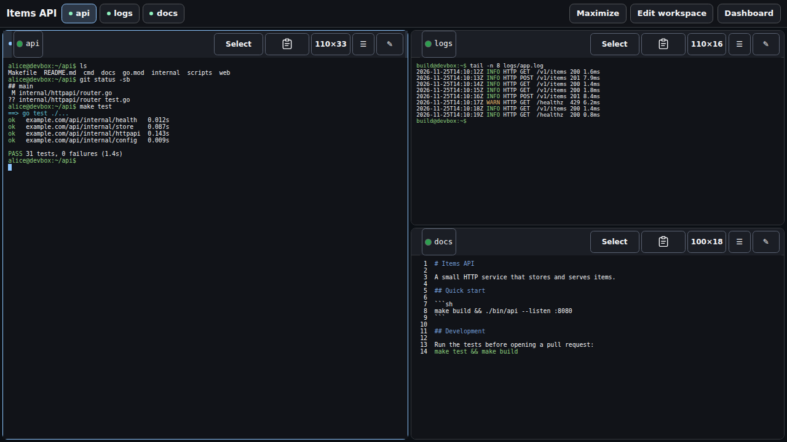
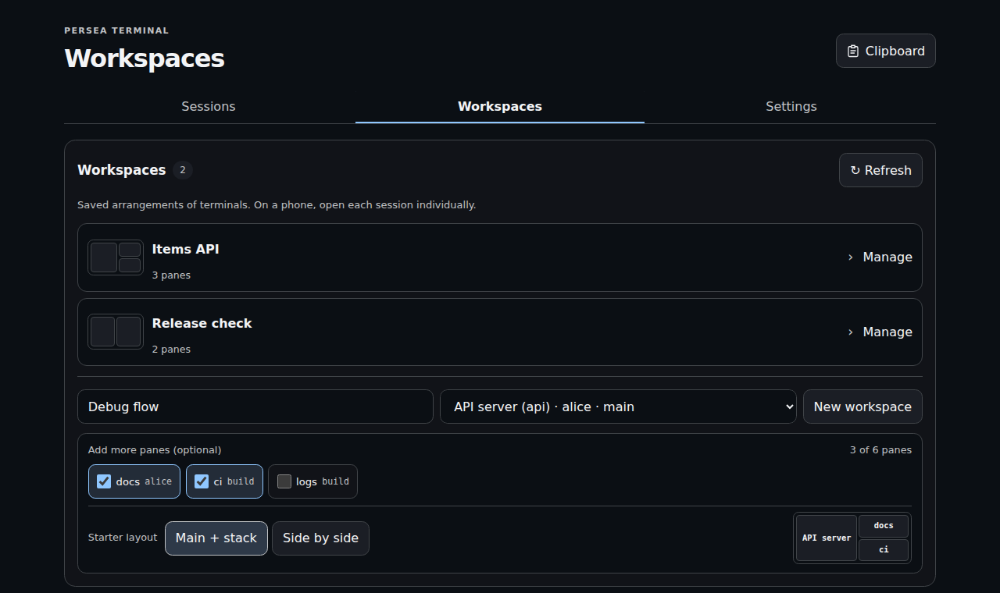

# Workspaces

Workspaces group up to six tmux sessions into a single desktop browser tab using
nested row and column splits. Saved workspaces persist on the front door and are
available across an operator's desktop browsers.



## Saved model and storage

A saved workspace stores only its display name and a recursive split tree whose
leaves name sessions by selector (`realm`, `server`, `name`), an optional
`alias_hint`, and an `on_missing` policy (`offer`, `create`, or `skip`). It
never stores capability handles, tmux session IDs, incarnation keys, or terminal
geometry.

- **Store path:** `/var/lib/persea-terminal/workspaces.json` (rendered as
  `workspace_store_path` alongside the front's other owner-only `0700` stores).
- **Bounds:** up to 64 saved workspaces per operator, 1 to 6 panes per
  workspace, 2 to 4 children per split, maximum split depth 3, unique leaves per
  workspace, and 256 KiB total store size.
- **Validation and concurrency:** malformed trees or over-cap writes fail closed
  as a whole. Updates and deletions use ETag / `If-Match` revision checks; a
  `409` conflict preserves the operator's draft with reload/retry choices.

## Creating and managing workspaces



Each saved workspace card on the dashboard **Workspaces** tab renders a
miniature layout diagram, its pane count, and passive availability exceptions
derived from the already-loaded session inventory (without extra polling).

- **Multi-session builder (desktop):** choose a name, pick a primary session,
  optionally check up to five additional sessions, select a starter layout
  preset (such as **Main + stack**, **Side by side**, or grid arrangements),
  and preview the labeled layout diagram before saving. After creation, an
  inline **Open** link opens the new workspace directly.
- **Manage disclosure:** reveals member session details, inline rename, desktop
  duplication, and deletion. Deletion requires confirming the workspace name and
  removes only the saved layout — it never closes any tmux session.
- **Draft resilience:** in-progress workspace drafts survive background,
  foreground, and manual inventory refreshes as well as `409` and `507` errors.

## Runtime behavior and invariants

Opening a workspace navigates to `/workspace?engine=unified-dev#name=<name>` and
shows a landing card first. Navigating to a workspace URL never auto-attaches;
the operator starts attachments with a trusted **Open workspace** click.

- **Presentation-only layout:** split weights are CSS flex proportions only.
  Dragging a divider, nudging a split, maximizing a pane, or resizing the
  browser window never emits `RESIZE_REQUEST` to tmux. Each cell refits only its
  own font presentation.
- **Maximize and Restore grid:** **Maximize** expands the active pane to fill
  the workspace grid in CSS while keeping sibling panes attached in the
  background (no disconnect, reconnect, or tmux resize). Click **Restore grid**,
  press `Alt+Shift+F6` then `Z`, or select another pane in the header picker to
  exit maximize cleanly.
- **Header chrome and pane focus:** the single workspace header holds the
  workspace name, pane picker pills (`1`–`6`), **Maximize**, **Edit workspace**,
  and **Dashboard**. Pane headers omit workspace-level controls and lock
  dividers during normal operation so terminal space stays uncluttered. A
  designated-pane focus veto ensures background reconnects in sibling panes
  never steal keyboard focus from the active pane.
- **Keyboard pane picker:** press `Alt+Shift+F6` from a terminal pane to focus
  the header pane picker. Use `←`/`→`/`Home`/`End` to move across pills, `1`–`6`
  to activate a pane directly, `Z` to toggle maximize on the focused pill, and
  `Escape` to return focus to the designated pane.
- **Single-flight inventory and honest pane states:** all panes in a workspace
  share one single-flight `/api/inventory` fetch at a time. Every cell renders
  an explicit visible state (live, connecting, missing with create/skip,
  ambiguous, blocked projection, reconnecting/reattaching, displaced/takeover,
  rate-limited) so a workspace never shows a silent blank pane.

## Visual layout editor and switched panes

Clicking **Edit workspace** switches the grid into layout-edit mode:

- **Unlocked layout controls:** add panes (up to the 6-pane cap), split or
  unsplit cells, swap or replace sessions, remove panes, drag or nudge dividers,
  and apply starter presets. Editor tiles show live session labels (current
  aliases and tmux names) from the latest inventory.
- **Switched-pane reconciliation:** switching a pane's session through its
  in-pane identity menu updates only that live pane without mutating the saved
  workspace. On a saved workspace, a **Save switch** button in the header lets
  you persist the switched pane back to the saved workspace in one click; inside
  **Edit workspace**, each switched pane also exposes a **Use current** button.
  Reconciliation tracks exact `(paneKey, switchedSession)` pairs so consecutive
  switches or multi-pane edits never overwrite the wrong leaf.
- **Save guard:** while a save request is in flight, **Cancel** is disabled so
  an in-flight save cannot race a local discard. If the server reports a
  revision conflict (`409`), the draft stays intact for review.

## Phone posture

Multi-pane grids are desktop-only (`ui/src/workspace_posture.ts`). On phones,
the Workspaces tab omits creation and duplication controls, and opening a
workspace URL displays an honest card listing each member session with an
individual **Open** link so each session opens cleanly in single-terminal view.

## Verification

Run the workspace unit and browser gates from `ui/`:

```sh
npm run test:workspace-ux-browser       # Chromium + WebKit UX, editor, presets, Maximize, Save switch, phone posture
npm run test:workspace-runtime-browser  # multi-pane runtime, single-flight inventory, focus veto, error states
npm run test:workspace-layout-browser   # split tree rendering, dividers, exhaustive pane-state matrix
npm run test:browser:workspace          # full workspace CI lane (includes dashboard contract + private-stack refit)
```

Pure model and URL checks (`workspace_model.test.ts`, `workspace_url.test.ts`,
`workspace_inventory.test.ts`) run inside `npm run test:unit`; server storage
and route tests (`internal/frontdoor/workspace_*_test.go`) run inside
`go test ./...`.
